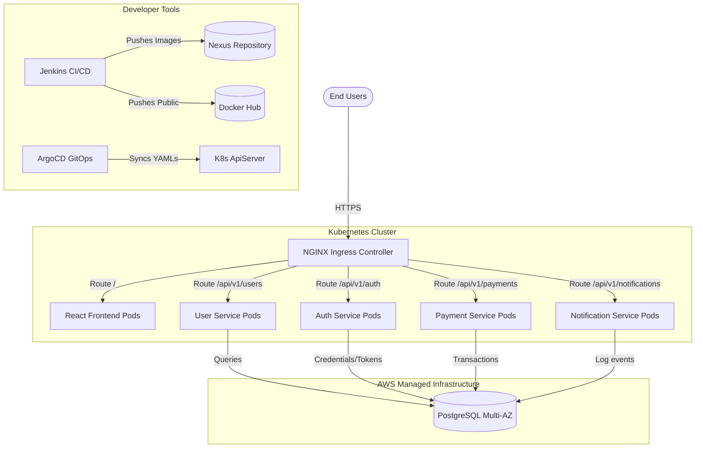
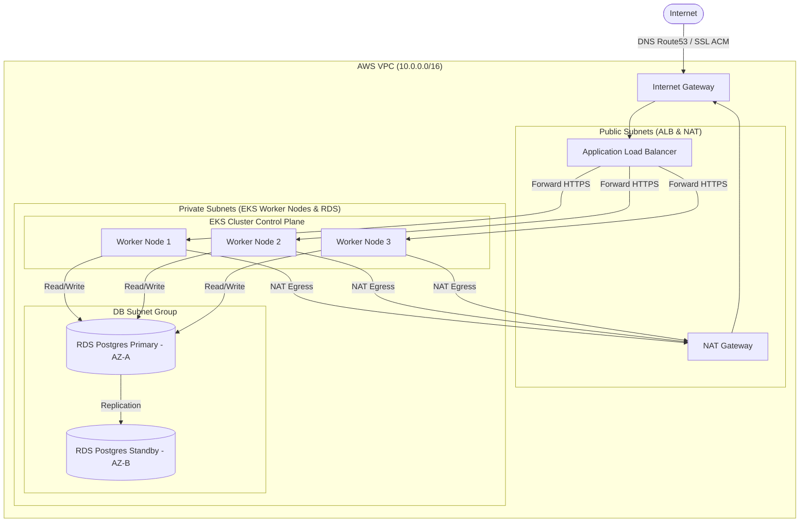
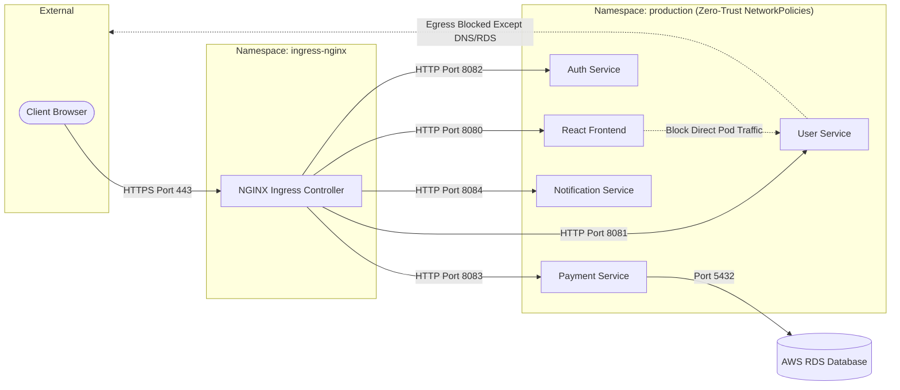
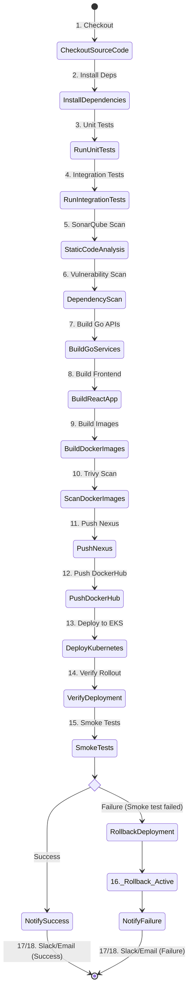

# Enterprise System Architecture & Diagrams

This document contains high-fidelity design specifications and architectural diagrams for the Enterprise Microservices Platform.

## 1. High-Level Architecture Diagram



---

## 2. AWS Infrastructure Diagram



---

## 3. Kubernetes Architecture Diagram

```mermaid
graph TB
    subgraph Kubernetes Cluster ["Kubernetes Cluster Nodes"]
        subgraph ControlPlane ["Master Control Plane"]
            ApiServer[kube-apiserver]
            Etcd[(etcd)]
            Scheduler[kube-scheduler]
            ControllerManager[kube-controller-manager]
        end

        subgraph Node1 ["Worker Node 1"]
            Kubelet1[Kubelet]
            KProxy1[Kube-Proxy]
            PodF1[Frontend Pod]
            PodU1[User Service Pod]
        end

        subgraph Node2 ["Worker Node 2"]
            Kubelet2[Kubelet]
            KProxy2[Kube-Proxy]
            PodA1[Auth Service Pod]
            PodP1[Payment Service Pod]
        end

        subgraph Node3 ["Worker Node 3"]
            Kubelet3[Kubelet]
            KProxy3[Kube-Proxy]
            PodN1[Notification Service Pod]
            PodF2[Frontend Pod (Replica)]
        end
    end

    ApiServer --> Etcd
    Scheduler --> ApiServer
    ControllerManager --> ApiServer
    Kubelet1 --> ApiServer
    Kubelet2 --> ApiServer
    Kubelet3 --> ApiServer
```

---

## 4. Networking Diagram (Ingress & Namespace Isolation)



---

## 5. CI/CD Pipeline Flow Diagram (Jenkins 18 Stages)


